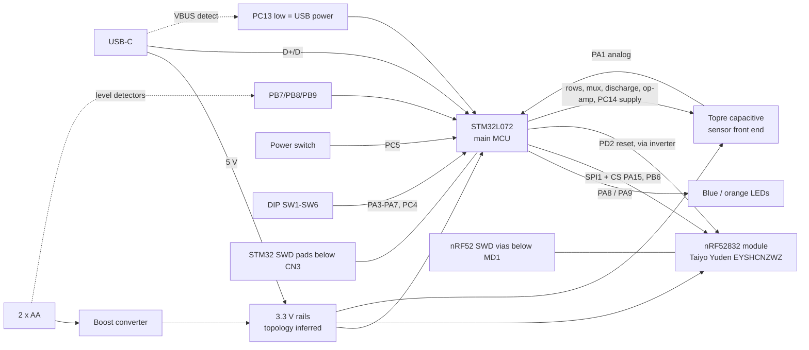

[ECK docs](overview.md)

# Hybrid hardware

The board as ECK sees it (PD-KB800BS, Hybrid Type-S). No schematic is available; facts come from ECK's code, bench measurements and the [stock firmware analysis](hybrid-stock-behaviour.md). Tags: **measured** (bench; PPK2 sourcing 3.0 V at the battery terminals unless stated), **tested** (behaviour checked on the board), **code** (what ECK or stock firmware does), **datasheet**, **inferred** (not checked). Bare file names are under `stm32/`.

## 1. Overview

| Block | Part | Role |
| --- | --- | --- |
| Main MCU | STM32L072RBT (LQFP64, 128 KB flash, device ID 0x447) | Key scanning, USB HID, power management, link master |
| Radio | nRF52832 AAE0 (512 KB flash, 64 KB RAM) in module MD1, Taiyo Yuden EYSHCNZWZ | BLE HID keyboard; ECK's app is an SPI slave of the STM32 |
| Sensor front end | 4 row strobes × 15 columns through two analog muxes, discharge switch, op-amp, ADC input | Topre capacitive key sensing |
| Power | 2 × AA, boost converter, USB-C 5 V | Section 5 |
| UI | Power switch (PC5), blue LED (PA8), orange LED (PA9), 6 DIP switches | |

The STM32 side matches the HHKB Classic: stock pin setup is identical, except that the Classic parks the SPI1 pins (PB3-PB6, PA15) as outputs because it has no nRF52.

## 2. STM32L072

### Clocks

| Source | Use | Where |
| --- | --- | --- |
| HSI16 ×4 /2 = 32 MHz PLL | System clock when booted on USB power (range 1, 1 wait state) | `board/platform.c` |
| HSI16, PLL off | System clock when booted on batteries; the PLL costs ~2.5 mA (measured) | `hybrid/hybrid.c` |
| HSI48 + CRS (USB SOF) | Crystal-less USB; off on batteries with USB (1.4 mA together, measured) | `platform.c`, `hybrid_power.c` |
| HSI16 after STOP | Wake clock (`RCC_CFGR.STOPWUCK`) | `hybrid_sleep.c` |
| LSI (37 kHz typ., 26-56 kHz) | LPTIM1 /16 keeps FreeRTOS time across STOP; rate measured against SysTick at start-up | `hybrid/hybrid_sleep.c` |
| LSE | **None**: PC14 (OSC32_IN) is the sensor supply output | code |
| TIM2 | 4 ticks/µs, scan pacing and settle delays; stops in STOP | `ec/matrix.c` |
| ADC clock | PCLK/2 at 32 MHz, PCLK/1 at 16 MHz (16 MHz either way) | `boards/hhkb/classic_matrix.c` |

The clock is chosen at boot from PC13; a USB power change while ON resets the STM32.

### Memory map

Flash: two 64 KB banks, 128-byte pages. Data EEPROM: 6 KB at `0x08080000` in two 3 KB banks (RM0367, DS10689).

| Range | Content | Source |
| --- | --- | --- |
| `0x08000000` Bank 1 | ECK boot stub (1.4 KB, under 3 KB, `0xFF` to `0x08000FFF`); PFU's updater and fallback firmware on stock | `boot/boot.ld`, `boot/README.md` |
| `0x08001000` Bank 1 | Bluetooth-staged STM32 image (up to `0xEF80` bytes); install header at `0x0800FF80` | `hybrid/bank1_stage.h` |
| `0x08010000` Bank 2 | ECK app (64 KB) | `board/stm32l072_bank2.ld` |
| `0x20000000` | SRAM, 20 KB | same |
| `0x1FF00000` | System memory: ST's USB DFU loader (`0483:DF11`, "STM32 BOOTLOADER") | `hybrid/rom_dfu.h` |

Data EEPROM. `0x08080000-0x080805FF` and `0x08081000-0x080813FF` are PFU's (keep them to return to stock); ECK owns `0x08080600-0x08080FFF` and `0x08081400-0x080817FF`, 444 B of which are free (plus 544 B of padding inside the keymap slots):

| Address | Use | Source |
| --- | --- | --- |
| `0x08080310-0x0808034F` | PFU factory info block (stock command 0x02 returns it); ECK doesn't write it on the Hybrid | stock code |
| `0x08080360` | Bank 2 installed = 1 (PFU layout, kept) | `boot/boot.c` |
| `0x08080370` | CRC-16/MCRF4XX of Bank 2 (low half-word); 0 keeps Bank 1 in its updater/loader | `boot/boot.c`, `hybrid/hybrid.h` |
| `0x08080600-0x08080FFF` | Keymap slots: two 1,280-byte copies (16-byte header, 240 keys as 16-bit VIA codes, 512 B macros, 272 B unused), tag `ECK3` | `via/hhkb_keymap_storage.c` |
| `0x08081000` | Factory rest levels per key (256 B) | `ec/ec_settings.c` |
| `0x08081100`, `0x08081200` | Factory press thresholds and offsets per key (index `8*col+row`) | `boards/hhkb/classic_matrix.c` |
| `0x08081350` | Set by stock E0, cleared by PFU's Bank 1; meaning unknown | stock code |
| `0x08081400-0x080814FF` | Free (stock keymap save 0) | |
| `0x08081500` | ECK settings record (264 B: calibration, Rapid Trigger, hold-tap, LED modes) | `ec/ec_settings.c` |
| `0x08081608-0x0808173F` | Vial entries record (312 B, tag `VIAL`) | `via/vial.c` |
| `0x08081740-0x080817F7` | Free | |
| `0x080817F8` | Bluetooth settings (slot, transport; bits 16-18, the retired Bluetooth scan rate, written 0) | `hybrid/hybrid_ble.c` |

Boot: ECK's stub starts the ROM DFU loader if PC5 is held while PC13 shows USB power, or if Bank 2 fails its check (sane vectors, `0x360` = 1, CRC at `0x370` matches); otherwise it jumps to Bank 2 (tested). Option bytes: RDP 0, no write protection, BFB2 off.

**Programming flash from code** (RM0376 ch. 3; ECK's Bluetooth updates and boot stub): 128-byte pages, 64-byte half pages; erased flash reads 0 and a non-zero word can't be programmed (NOTZEROERR), so erase first. Page erase, word and half-page program take ~3.2 ms each. One bank erases or programs while code runs from the other. Between a half page's 1st and 16th word nothing may touch flash in either bank (a fetch aborts it with FWWERR, a data read hard-faults): the loop and its source run from RAM with interrupts masked. Keys: PEKEYR `0x89ABCDEF`, `0x02030405`; PRGKEYR `0x8C9DAEBF`, `0x13141516` (a wrong key hard-faults); setting PELOCK relocks all; EOP is set only when not aborted.

### Pin table

As ECK configures them; "stock" items come from PFU's firmware.

| Pin | Function | Dir / level | Source |
| --- | --- | --- | --- |
| PA1 | Op-amp output, ADC_IN1 | Analog | `classic_matrix.c` |
| PA3-PA7 | DIP SW1-SW5 | Input, pull-up, low = ON; analog after start-up on batteries | `boards/hhkb/dip_switch.c`, `hybrid_power.c` |
| PA8 | Blue LED | Output, high = on | `hybrid_power.c` |
| PA9 | Orange LED | Output, high = on; wins over blue | `hybrid_power.c` |
| PA10 | Stock: digital input without pull, never read (A048, emulated and disassembled 2026-11-21) | Unused | stock code |
| PA15 | Link CS to nRF52 P0.22 | Output, high idle (GPIO) | `hybrid_ble.c` |
| PB0, PB1, PB2, PB10 | Row strobes 0-3 | Output, low = selected | `classic_matrix.c` |
| PB3 / PB4 / PB5 | SPI1 SCK (board pull-up, tested) / MISO / MOSI to P0.25 / P0.24 / P0.23 | AF0 | `hybrid_ble.c` |
| PB6 | To nRF52 P0.18 (stock: attention pulse) | Output, low; high while the nRF52 starts = recovery mode | `ble_link.h` |
| PB7, PB8, PB9 | Battery detector outputs, low = below threshold 1/2/3 | Input, no pull | `hybrid_power.c` |
| PB11 | Unused fifth row slot (stock) | Unused | stock code |
| PB12-PB14 | Mux address (column & 7) | Output | `classic_matrix.c` |
| PB15 / PC6 | Mux select, columns 8-14 / 0-7 | Output | same |
| PC4 | DIP SW6 | Input, pull-up, low = ON | `dip_switch.c` |
| PC5 | Power switch, low = pressed | Input, pull-up; EXTI5 falling wakes STOP | `hybrid_power.c` |
| PC7 | Op-amp enable, high = on (during scans) | Output | `classic_matrix.c` |
| PC8 | Discharge switch (C57), high pulse | Output | same |
| PC9 | Stock: output driven low from start-up, never changed (A048, 2026-11-21) | Unused | stock code |
| PC13 | USB power, low = present (VBUS wiring inferred) | Input, no pull; EXTI13 falling wakes STOP | `hybrid_power.c` |
| PC14 | Sensor supply, high = on | Output | `classic_matrix.c` |
| PD2 | nRF52 reset, high = held (to P0.21 through an inverter, inferred from PSELRESET; tested with `nrf_reset_probe.py`) | Output, low in operation; stock pulses it at boot | `hybrid.c` |

## 3. nRF52832 module

| Item | Value | Source |
| --- | --- | --- |
| Module | Taiyo Yuden EYSHCNZWZ (MD1): DC/DC LC filter, 32 MHz and 32.768 kHz crystals (`backups/vendor-docs/TY_EYSHCNZWZ.pdf`) | datasheet |
| Supply | 1.7-3.6 V, from the board rail | datasheet, inferred |
| DC/DC | Enabled, as PFU's app does | `nrf52/main.c` |
| LF clock | Module crystal, declared 100 ppm (the datasheet doesn't promise 50 ppm over temperature) | `nrf52/config/app_config.h` |
| SoftDevice | S132 v7.2.0, shipped in ECK's `.hfb` (stock: v6.0.0). The MBR at `0x0` stays PFU's (v2.2.2, from S132 v6.0.0): the `.hfb` doesn't cover it, and Nordic's MBR 2.4.1 is a backward-compatible configuration change. S132 v7.2.0 under MBR 2.2.2 tested 2026-11-16 (boot, recovery mode, pairing) | `.hfb`; tested |
| Protection | Not read-protected (APPROTECT erased) | read over SWD |

### Link to the STM32

| Signal | STM32 | nRF52 | ECK use |
| --- | --- | --- | --- |
| CS | PA15 | P0.22 | GPIO on the STM32; SPIS CSN with pull-up |
| SCK | PB3 | P0.25 | SPI1 master, mode 0, MSB first |
| MOSI | PB5 | P0.23 | |
| MISO | PB4 | P0.24 | SPIS1; 0xFF when not ready |
| Recovery request | PB6 | P0.18 | High while the nRF52 starts: recovery mode |
| Reset | PD2 | P0.21 via inverter | ~5 ms pulse |

Wiring tested with `tools/bench/pin_map.py --drive`. SPI clock PCLK/16: 2 MHz on USB, 1 MHz on batteries. Frames: 32 bytes each way (magic, sequence, type, length, 27 data bytes, check byte; `common/ble_link.h`; VIA over Bluetooth: [Hybrid port](hybrid-port.md#bluetooth)). Stock is reversed: the nRF52 is master (SPI0, mode 3, ~125 kbit/s), driven by PB6 pulses.

The STM32 resets the nRF52 when it doesn't answer within 500 ms of boot (it may be in System OFF), after 5 s without a valid reply (at most once per 30 s), and after an aborted update (`hybrid_ble.c`).

### Flash map (512 KB, 4 KB pages)

| Range | Content |
| --- | --- |
| `0x00000` | MBR |
| `0x01000-0x25FFF` | S132 (v7.2.0 with ECK, v6.0.0 stock; `.hfb` nRF section starts here) |
| `0x26000` | App (ECK linked for up to 64 KB; PFU's is 45 KB); RAM from `0x20003800` (was `0x20002250` before VIA and updates over Bluetooth) |
| `0x36000` | Update record (size, MD5, CRC-16/MODBUS), `nrf52/nrf_update.c` |
| `0x37000` | Staged image of `0x1000-0x35FFF` (max `0x35000` bytes) |
| `0x70000-0x77FFF` | Stock: PFU app data (likely bonds) |
| `0x75000-0x77FFF` | ECK: FDS bond storage (3 pages, SDK default) |
| `0x78000-0x7FFFF` | PFU bootloader (UICR BOOTLOADERADDR); installs a staged image at reset |

## 4. Key matrix and sensor front end

A key press changes the coupling between a row strobe and the column's sense line. The STM32 reads one key at a time (`classic_matrix.c`):

1. Rows deselected (high), op-amp on; on batteries the ADC is enabled for the scan only. After 20 µs for the op-amp, each mux half (columns 0-7, then 8-14, 50 µs settle between) is read with interrupts off, since readings depend on the timing between keys.
2. Per column: select the mux and set the address.
3. Per row: wait 2 µs, pulse discharge 2 µs, drive the row low, wait 3 µs, convert PA1 (12 bit, shortest sample time, one conversion), deselect.
4. Compare with thresholds (factory threshold with a 50-count release margin by default; otherwise the calibrated range, hysteresis 10 %).
5. Op-amp off; on batteries the ADC and its regulator off.

PC14 stays high while the keyboard is on.

| Item | Value | Source |
| --- | --- | --- |
| Scan rates | Fixed: 1000 Hz on USB, 250 Hz on Bluetooth, paced by TIM2 | `ec_settings.c`, `matrix.c` |
| Hybrid default | 1000 Hz USB, 250 Hz Bluetooth | `hybrid_ble.c` |
| During an nRF52 update | 50 Hz | `classic_matrix.c` |
| Idle stage | 50 Hz, STOP between scans, after 5 s without key changes (batteries, Bluetooth) | `matrix.c` |
| USB sleep | 50 Hz without STOP while the host has suspended USB (USB output; every model); full rate again on resume | `matrix.c`, `ec_settings.c` |
| Rest / press levels | Rest 25-690 counts; factory press thresholds 1560-2190 | measured |

## 5. Power

### Supply path

| Item | Detail | Tag |
| --- | --- | --- |
| Batteries | 2 × AA into a boost converter: bursts every 7.5 ms at light load; current rises as the battery voltage falls | measured |
| Board floor | ~130-140 µA base plus boost bursts: 0.20 mA in OFF | measured |
| USB | 5 V from USB-C; regulation and how USB and battery paths combine are unknown | inferred |
| Rail | 3.28 V on the SWD VCC pad on USB power | measured |
| Battery level | Three detector outputs PB7/PB8/PB9 (no ADC); level 0-3 → 100/15/5/0 %. Thresholds at the terminals, falling: 2.10-2.125 V, 2.025-2.05 V, 1.925-1.95 V (about 1.05 / 1.02 / 0.97 V per cell); the keyboard won't start below level 3 | code; measured with `tools/bench/battery_sweep.py` |

### States

| State | STM32 | nRF52 | Wake / exit | Battery current at 3.0 V |
| --- | --- | --- | --- | --- |
| ON, USB power | 32 MHz PLL, USB on | As selected | | (USB powered) |
| ON, batteries | 16 MHz, USB off, ADC only during scans, DIP pins analog after start-up | Connected | | 4.3 mA just after typing; 7.5 mA pairing |
| Idle stage | 50 Hz scan, STOP between scans, LPTIM1 wake | Connected | Key change | **1.50 mA** (3.55 mA with Sleep instead of STOP) |
| Deep sleep (auto power-off) | STOP; 8 key checks/s with sensor supply on and rows deselected; ULP off so VREFINT stays for the ADC | System OFF | Key down in two consecutive checks (1 s blue), switch, USB power → reset | **0.33 mA** |
| OFF | STOP with ULP; LEDs, USB, ADC, sensor supply, op-amp, mux, rows low; DIP, battery and SPI data pins analog | System OFF | Switch held 1 s, or USB power → reset | **0.20 mA** (stock 198 µA) |
| Stock, idle running | | | | 5.1 mA |

All measured. Every power-on from OFF is an STM32 reset, which also restarts the nRF52.

Component costs (batteries, 3.0 V): 32 MHz PLL ~2.5 mA; USB + HSI48 + CRS 1.4 mA; always-on ADC plus DIP pull-ups ~1.1 mA; each ON DIP switch ~0.1 mA; scanning ~6 µA per Hz at 32 MHz; nRF52 idle ~0.3 mA; sensor supply on with a row driven low ~0.75 mA; recharging the sensor supply ~25 µC. So deep sleep keeps PC14 on with the rows deselected rather than switching the supply per check.

## 6. Debug and recovery access

| Access | Detail | Tag |
| --- | --- | --- |
| STM32 SWD | Five pads below CN3: `GND NRST VCC` over `SWCLK SWDIO`. **NRST is needed**: ECK's idle `wfi` stops the debug clock, so connect under reset (`STM32_Programmer_CLI -c port=SWD freq=1000 mode=UR reset=HWrst`). Builds booted on USB power set `DBGMCU_CR.DBG_SLEEP`, so `mode=HOTPLUG` also works there. `tools/bench/swd_flash.py` writes Bank 2 and the two boot words | tested |
| nRF52 SWD | Two vias below MD1's bottom-right corner, by the "15" silkscreen: SWDCLK upper, SWDIO lower (module pins 15/14, GND 13). pyOCD with a Pico debugprobe: `-t nrf52832 -O auto_unlock=false` (**auto-unlock mass-erases**) | tested |
| SWD on batteries | Fails on both chips; cause unknown | measured |
| SWD read glitch | STM32 SRAM/peripheral reads sometimes return 0 while the core sleeps; repeat a surprising read | measured |
| STM32 recovery | Batteries out, hold the power switch and plug in USB: ST's DFU loader (`0483:DF11`); also when Bank 2 fails its check | tested |
| Logs | nRF52 RTT (`make NRF_LOG=1`); `tools/bench/rtt_dump.py` | code |

### HFB container

Stock: 282,672 bytes. Built by `tools/make_hfb.py --nrf-app --softdevice`.

| Offset | Content |
| --- | --- |
| `0x00000` | Outer CRC-16/MCRF4XX over the rest |
| `0x00002` | Inner CRC of the 64 KB STM32 section (= EEPROM `0x08080370` tag) |
| `0x00004` | STM32 Bank 2 image, 64 KB |
| `0x10004` | 12 × `0xFF` |
| `0x10010` | MD5 of the nRF52 section |
| `0x10020` | nRF52 image from `0x1000` (SoftDevice + app) |
| end - `0x10` | Model `AHUX01`, version (`0A 00 04 08` = A0.48), 6 × `0xFF` |

Bank 1 relays the nRF52 part over SPI in 57-byte chunks as they arrive.

## 7. Open questions

- The battery detector part.
- Why SWD fails on battery power (idea: power USB-C from a charger, check probe GND against the USB-C shell).
- Power path: the regulator from USB 5 V, how USB and boost combine, whether the boost runs on USB.
- Stock pulls on PC5, PC13 and PB7-PB9; stock idle levels of the matrix pins in OFF.
- What STM32 PA10/PC9 connect to (the four series resistors left of MD1 are not the link). nRF52 P0.11/P0.12 don't matter: PFU's A048 nRF52 app sets them as inputs with pull-ups (`PIN_CNF` `0xC`, no sense, at `0x28a62`) and never reads them or gives them a GPIOTE channel (only P0.18 has one); ECK leaves them at reset (2026-11-21).
- Whether the nRF52 shares the STM32's rail.
- Mux enable polarity on PC6/PB15 (code drives PC6 high and PB15 low for columns 0-7, and the reverse for 8-14).
- Meaning of EEPROM `0x08081350`.
