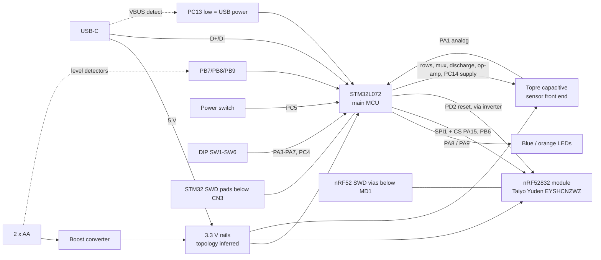
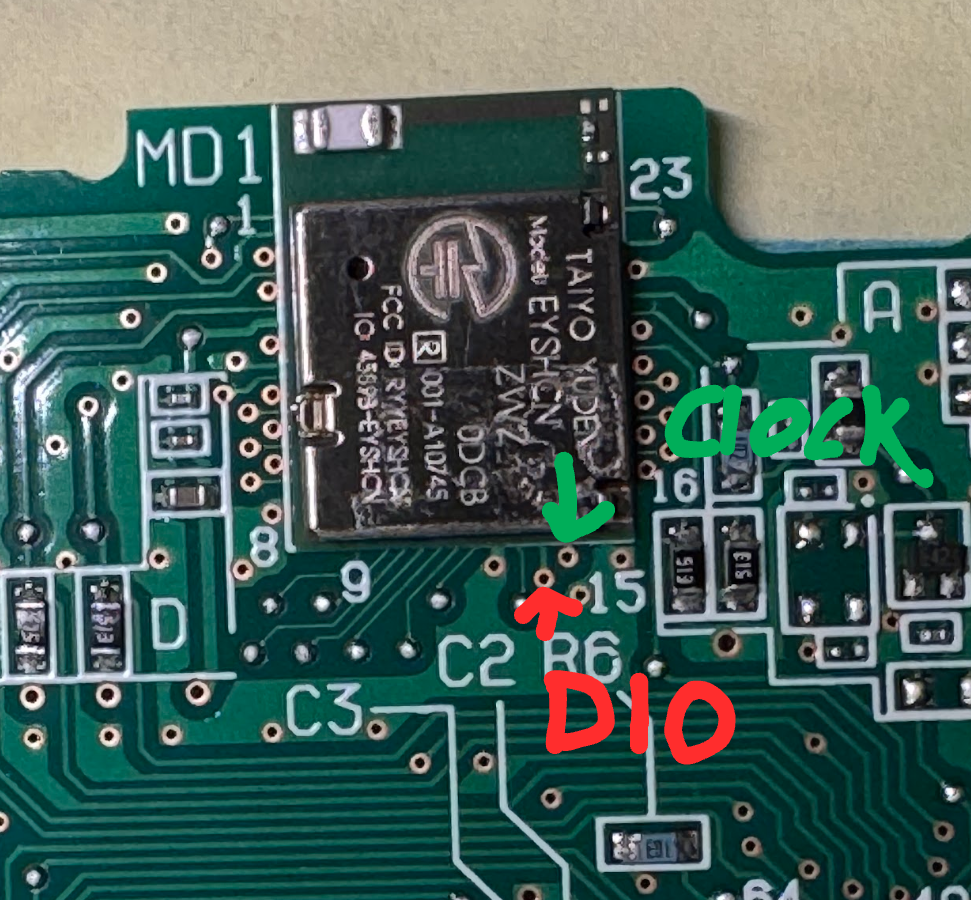

**Documentation:** [Install](install.md) • [Backup & restore](backup-restore.md) • [Build](build.md) • [Config](config.md) • [VIA](via.md) • [Hybrid port](hybrid-port.md) • [Hybrid updates](hybrid-update.md) • [Hybrid hardware](hybrid-hardware.md)

# HHKB Professional Hybrid: hardware architecture

The board as ECK sees it: test keyboard PD-KB800BS (Hybrid Type-S, USB `04FE:0021`). Facts come from the port notes ([hybrid-port.md](hybrid-port.md)), the stock-firmware analysis ([hybrid-stock-behaviour.md](hybrid-stock-behaviour.md)), ECK's code and bench measurements. No schematic is available.

Tags used below: **measured** (bench, PPK2 sourcing 3.0 V at the battery terminals, battery-side current, unless stated), **tested** (behaviour checked on the board), **code** (what ECK or stock firmware does; the board wiring follows from it working), **datasheet**, **inferred** (not checked). Paths are relative to the repository root; bare file names are under `stm32/`.

## 1. Overview

| Block | Part | Role |
| --- | --- | --- |
| Main MCU | STM32L072RBT: LQFP64 package (seen on the board, R = 64 pins, T = LQFP) and 128 KB flash (STM32CubeProgrammer: device ID 0x447, 128 KB; B = 128 KB) | Key scanning, USB HID, power management, link master |
| Radio | nRF52832 (variant AAE0, 512 KB flash, 64 KB RAM, read over SWD) in module MD1, Taiyo Yuden EYSHCNZWZ | BLE HID keyboard; ECK's app is an SPI slave of the STM32 |
| Sensor front end | 4 row strobes x 15 columns through two analog muxes (4051 on the Classic, `build.md`), discharge switch, op-amp, ADC input | Topre electrostatic-capacitive key sensing |
| Power | 2 x AA, boost converter, USB-C 5 V | See section 5 |
| UI | Power switch (PC5), blue LED (PA8), orange LED (PA9), 6 DIP switches | |

The STM32 side is the same as the HHKB Classic (stock pin set identical; the Classic parks the SPI1 pins as outputs because it has no nRF52; [hybrid-port.md](hybrid-port.md), "STM32 pins").

## 2. STM32L072

### Clocks

| Source | Use | Where |
| --- | --- | --- |
| HSI16 x4 /2 = 32 MHz PLL | System clock when booted on USB power (voltage range 1, 1 wait state) | `stm32/board/platform.c` |
| HSI16, 16 MHz, PLL off | System clock when booted on batteries (PC13 high); the PLL costs ~2.5 mA (measured) | `stm32/hybrid/hybrid.c` |
| HSI48 + CRS (synced to USB SOF) | USB, crystal-less; switched off on batteries with USB itself (1.4 mA together, measured) | `platform.c`, `hybrid_power.c` |
| HSI16 after STOP | Wake clock (`RCC_CFGR.STOPWUCK`) | `hybrid_sleep.c`, `hybrid_power.c` |
| LSI (37 kHz typ., 26-56 kHz, datasheet) | LPTIM1 /16 keeps FreeRTOS time across STOP; its rate is measured against SysTick at start-up | `stm32/hybrid/hybrid_sleep.c` |
| LSE | **None**: PC14 (OSC32_IN) is the sensor supply output, so no 32 kHz crystal (code) | `hybrid_sleep.c` |
| TIM2 | 4 ticks/us, scan pacing and sensor settle delays; stops in STOP | `stm32/ec/matrix.c`, `classic_matrix.h` |
| ADC clock | Synchronous PCLK/2 at 32 MHz, PCLK/1 at 16 MHz = 16 MHz | `stm32/ec/classic_matrix.c` |

The source of the clock is chosen once at boot from PC13; a change of USB power while ON resets the STM32 (`hybrid_power.c`).

### Memory map

Flash is two 64 KB banks, 128-byte pages; data EEPROM 6 KB at `0x08080000` in two 3 KB banks (RM0367 Table 8, category 5; STM32L072 datasheet DS10689, `backups/vendor-docs/DS_stm32l072rb.pdf`).

| Range | Content | Source |
| --- | --- | --- |
| `0x08000000-0x0800FFFF` Bank 1 | ECK boot stub (`stm32/boot/`, ~720 B, linked in 4 KB, no RAM data); PFU's updater + fallback keyboard firmware on stock | `stm32/boot/boot.ld`, `stm32/boot/README.md` |
| `0x08010000-0x0801FFFF` Bank 2 | ECK app (64 KB) | `stm32/board/stm32l072_bank2.ld` |
| `0x20000000`, 20 KB | SRAM | same |
| `0x1FF00000-0x1FF01FFF` | System memory (8 KB, RM0367): ST's USB DFU loader (`0483:DF11`, "STM32 BOOTLOADER") | `stm32/hybrid/rom_dfu.h` |

Data EEPROM words the Hybrid uses. `0x08080000-0x080805FF` and `0x08081000-0x080813FF` are PFU's (keep them to return to stock); ECK owns `0x08080600-0x08080FFF` and `0x08081400-0x080817FF`, 756 B of which are free:

| Address | Use | Source |
| --- | --- | --- |
| `0x08080310-0x0808034F` | PFU factory info block (returned by stock command 0x02); ECK does not write it on the Hybrid | hybrid-port.md |
| `0x08080360` | Bank 2 installed = 1 (PFU layout, kept) | `stm32/boot/boot.c` |
| `0x08080370` | CRC-16/MCRF4XX of the 64 KB Bank 2 (low half-word); 0 keeps Bank 1 in its updater/loader | `stm32/boot/boot.c`, `stm32/hybrid/hybrid.h` |
| `0x08080600-0x08080FFF` | ECK keymap slots: two 1,280-byte copies, each a 16-byte header, 240 keys as 16-bit VIA codes and 512 B of macros (`ECK3`; 272 B per slot unused); zero in the stock dump | `stm32/via/hhkb_keymap_storage.c` |
| `0x08081000` | Factory rest levels per key (256 B) | `stm32/ec/ec_settings.c` |
| `0x08081100`, `0x08081200` | Factory press thresholds and offsets per key (index `8*col+row`); used while custom calibration and Rapid Trigger are off (the default for a keyboard with no saved settings) | `stm32/ec/classic_matrix.c` |
| `0x08081350` | Set by stock E0, cleared by PFU's Bank 1; meaning unknown | hybrid-port.md |
| `0x08081400-0x080814FF` | Free (the stock firmware's keymap save 0; zero on the bench keyboard) | |
| `0x08081500` | ECK settings record (264 B: calibration, scan rate, LED modes) | `stm32/ec/ec_settings.c` |
| `0x08081608-0x080817F7` | Free | |
| `0x080817F8` | Hybrid Bluetooth settings (slot, transport preference, Bluetooth scan rate) | `stm32/hybrid/hybrid_ble.c` |

Boot: Bank 1 runs first. ECK's stub starts the ROM DFU loader if PC5 is held while PC13 shows USB power, or if Bank 2 fails the rule (sane vectors, `0x360` = 1, CRC at `0x370` matches); otherwise it jumps to `0x08010000` (tested). Option bytes: RDP 0, no write protection, BFB2 off (read over SWD).

### Pin table

Directions and levels as ECK configures them. "Stock" items are from static analysis of PFU's firmware.

| Pin | Function | Dir / level | Source |
| --- | --- | --- | --- |
| PA1 | Sensor op-amp output, ADC_IN1 | Analog | `classic_matrix.c` |
| PA3-PA7 | DIP SW1-SW5 | Input, pull-up, low = ON; analog after start-up on batteries | `stm32/board/dip_switch.c`, `hybrid_power.c` |
| PA8 | Blue LED | Output, high = on | `hybrid_power.c`; colour seen on board |
| PA9 | Orange LED | Output, high = on; wins over blue | `hybrid_power.c` |
| PA10 | Stock: input; purpose unknown | Not used by ECK | hybrid-port.md |
| PA15 | Link CS to nRF52 P0.22 | Output, high idle (GPIO, not SPI NSS) | `hybrid_ble.c` |
| PB0, PB1, PB2, PB10 | Sensor row strobes 0-3 | Output, low = row selected | `classic_matrix.c` |
| PB3 | SPI1 SCK to P0.25 (board pull-up, tested) | AF0 | `hybrid_ble.c` |
| PB4 | SPI1 MISO from P0.24 | AF0 | same |
| PB5 | SPI1 MOSI to P0.23 | AF0 | same |
| PB6 | To nRF52 P0.18 (stock: attention pulse) | Output, low; high while the nRF52 starts = its recovery mode | `ble_link.h`; stock: hybrid-stock-behaviour.md |
| PB7, PB8, PB9 | Battery level detector outputs, low = below threshold 1/2/3 | Input, no pull (stock pull unknown) | `hybrid_power.c` |
| PB11 | Unused fifth row slot (stock) | Not used | hybrid-port.md |
| PB12-PB14 | Column mux address (column & 7) | Output | `classic_matrix.c` |
| PB15 | Mux select for columns 8-14 (high), with PC6 for columns 0-7 | Output | same |
| PC4 | DIP SW6 (power saving) | Input, pull-up, low = ON | `dip_switch.c` |
| PC5 | Power switch, low = pressed | Input, pull-up (stock pull unknown); EXTI5 falling wakes STOP | `hybrid_power.c` |
| PC6 | Mux select for columns 0-7 (comment: "U1 enable") | Output | `classic_matrix.c` |
| PC7 | Op-amp enable, high = on (only during a scan) | Output | `classic_matrix.c` |
| PC8 | Discharge switch (C57), high pulse | Output | `classic_matrix.c` |
| PC9 | Stock: output; purpose unknown | Not used by ECK | hybrid-port.md |
| PC13 | USB power sense, low = present (VBUS wiring inferred) | Input, no pull; EXTI13 falling wakes STOP | `hybrid_power.c`, `hybrid.c` |
| PC14 | Sensor supply ("power switch board"), high = on | Output | `classic_matrix.c`, `hybrid_power.c` |
| PD2 | nRF52 reset, high = held in reset (to P0.21 through an inverter, inferred from UICR PSELRESET) | Output, low in operation | `hybrid.c` |
| SWDIO/SWCLK (PA13/PA14), NRST | Debug pads below CN3 | | hybrid-port.md |

Other stock-only facts: PC5/PC13 falling-edge EXTI in stock too; stock pulses PD2 high at boot.

## 3. nRF52832 module

| Item | Value | Source |
| --- | --- | --- |
| Module | Taiyo Yuden EYSHCNZWZ (MD1); built-in DC/DC LC filter and 32 MHz + 32.768 kHz crystals (module datasheet, `backups/vendor-docs/TY_EYSHCNZWZ.pdf`) | datasheet |
| Supply | VCC_NRF 1.7-3.6 V (module datasheet); fed from the board rail (inferred) | datasheet |
| DC/DC | Enabled by ECK (`sd_power_dcdc_mode_set`), as PFU's app does | `nrf52/main.c` |
| LF clock | Module crystal (SDK default `NRF_SDH_CLOCK_LF_SRC` = XTAL); accuracy declared 100 ppm because the module datasheet says it does not hold 50 ppm over temperature | `nrf52/config/app_config.h` |
| SoftDevice | S132 v6.0.0 (PFU's, unchanged) | hybrid-port.md |
| Reset | P0.21 (UICR PSELRESET), driven from STM32 PD2 high (tested with `tools/bench/nrf_reset_probe.py`) | hybrid-port.md |
| Protection | Not read-protected (APPROTECT erased, read over SWD) | hybrid-port.md |

### Link to the STM32

| Signal | STM32 | nRF52 | ECK use |
| --- | --- | --- | --- |
| CS | PA15 | P0.22 | GPIO on the STM32; SPIS CSN with pull-up on the nRF52 |
| SCK | PB3 | P0.25 | STM32 SPI1 master, mode 0, MSB first |
| MOSI | PB5 | P0.23 | |
| MISO | PB4 | P0.24 | nRF52 SPIS1; answers 0xFF when not ready |
| Recovery request | PB6 | P0.18 (SENSE in stock) | High while the nRF52 starts: recovery mode (link v6) |
| Reset | PD2 | P0.21 via inverter | Pulse ~5 ms at 32 MHz (~10 ms at 16 MHz, inferred from the loop) |

Wiring tested with `tools/bench/pin_map.py --drive`. SPI clock: PCLK2/16, 2 MHz at 32 MHz; on batteries (16 MHz) it is 1 MHz (inferred from the code). Frames: 32 bytes each way, magic, sequence, type, length, 27 data bytes, check byte (`common/ble_link.h`, link version 6). Stock is reversed: the nRF52 is master (legacy SPI0, mode 3, ~125 kbit/s) and pulses on PB6 drive it ([hybrid-stock-behaviour.md](hybrid-stock-behaviour.md)).

The STM32 resets the nRF52 through PD2 when it does not answer within 500 ms of boot (it may be in System OFF), after 5 s without a valid reply (at most once per 30 s), and when it reports an aborted update (`hybrid_ble.c`). Unknown: what P0.11/P0.12 (stock inputs with pull-up) connect to.

### Flash map (512 KB, 4 KB pages)

| Range | Content | Source |
| --- | --- | --- |
| `0x00000` | MBR | hybrid-port.md |
| `0x01000-0x25FFF` | S132 v6.0.0 | same; `.hfb` nRF section starts here |
| `0x26000` | App (ECK `hybrid_ble`, linked for up to 64 KB; PFU's app is 45 KB); RAM from `0x20002220` | `nrf52/hybrid_ble_gcc_nrf52.ld` |
| `0x36000` | Update record (size, MD5, CRC-16/MODBUS) | `nrf52/nrf_update.c` |
| `0x37000` | Staged image of `0x1000-0x35FFF` (max `0x35000` bytes) | `nrf_update.c` |
| `0x70000-0x77FFF` | Stock: PFU app data (likely bonds, inferred) | hybrid-port.md |
| `0x75000-0x77FFF` | ECK: FDS bond storage (3 pages, SDK default) | hybrid-port.md; SDK `sdk_config.h` |
| `0x78000-0x7FFFF` | PFU bootloader (UICR BOOTLOADERADDR); installs a staged image at the next reset | hybrid-port.md, hybrid-stock-behaviour.md (nRF52 staging) |

## 4. Key matrix and sensor front end

Topre switches are capacitive: a key press changes the coupling between a row strobe and the column's sense line. The STM32 reads one key at a time (`classic_matrix.c`, all code):

1. Before the scan: rows deselected (PB0/PB1/PB2/PB10 high), op-amp on (PC7 high); on batteries the ADC is enabled for the scan only (20 us regulator start, then ADEN). Wait 20 us for the op-amp to settle, then hold interrupts off for each mux half (cols 0-7, then 8-14, with a 50 us settle after the switch), since readings depend on the timing between keys. Debug and calibration output runs between and after the halves.
2. Per column (15): select the mux (PC6 for columns 0-7, PB15 for 8-14) and set the address PB12-PB14.
3. Per row (4): wait 2 us after the column or previous row (settle), pulse discharge PC8 high for 2 us, drive the row low, wait 3 us, convert PA1 (12 bit, shortest sample time, optional 4x oversampling at rates up to 500 Hz), deselect the row.
4. Compare with thresholds (PFU's factory threshold with a 50-count release margin by default; with custom calibration or Rapid Trigger, the calibrated range, default hysteresis 10 %). Key index `8*col + row` in PFU's tables.
5. After the scan: op-amp off; on batteries ADC and its regulator off.

The sensor supply PC14 is set high at init and stays on while the keyboard is on; OFF turns it low. Matrix: 4 x 15 (`config.h`).

| Item | Value | Source |
| --- | --- | --- |
| Scan rates | 50 / 125 / 250 / 500 / 1000 Hz (periods 20 / 8 / 4 / 2 / 1 ms, TIM2) | `matrix.c` |
| Hybrid default | 1000 Hz on USB, 250 Hz on Bluetooth (separate settings) | `classic_matrix.c`, `hybrid_ble.c` |
| 1000 Hz | Chattered on the Hybrid while interrupts could run during a scan; no chatter since the scan holds them off | tested, `classic_matrix.c` |
| During an nRF52 update | 50 Hz (1000 Hz starved the link task) | `classic_matrix.c` |
| Idle stage | 50 Hz paced by FreeRTOS, STOP between scans, after 5 s without key changes on batteries with Bluetooth as transport | `matrix.c`, `classic_matrix.c` |
| Scan cost | ~6 uA per Hz at 32 MHz | measured |
| Rest / press levels | Rest 25-690 counts; stock factory press thresholds 1560-2190 | hybrid-port.md (ADC diagnostics) |

## 5. Power

### Supply path

| Item | Detail | Tag |
| --- | --- | --- |
| Batteries | 2 x AA into a boost converter | measured (burst behaviour) |
| Boost behaviour | Bursts every 7.5 ms at light load; battery current rises as battery voltage falls | measured |
| Board floor | ~130-140 uA base plus boost bursts: 0.20 mA total in OFF | measured |
| Empty at power-on | Keyboard shuts down below ~1.9-2.0 V at the terminals (PB9 level 3) | measured |
| USB | 5 V from USB-C; rail regulation from it and how USB and battery paths combine are not known | inferred |
| Rail | 3.28 V on the SWD VCC pad on USB power (ST-Link target voltage) | measured |
| USB detect | PC13 low = USB power present | code (stock and ECK) |
| Battery level | Three detector outputs PB7/PB8/PB9 (no ADC, no nRF SAADC); level 0-3 -> 100/15/5/0 %; 100 % on USB power; filtered (worse at once, better after >10 samples at 100 ms). Thresholds at the battery terminals, falling: level 1 (PB7) 2.10-2.125 V, level 2 (PB8) 2.025-2.05 V, level 3 (PB9, empty) 1.925-1.95 V (about 1.05 / 1.02 / 0.97 V per cell) | code; thresholds measured (PPK2 sweep, warning flashes in the current trace, `tools/bench/battery_sweep.py`) |

### States

| State | STM32 | nRF52 | Wake / exit | Battery current at 3.0 V |
| --- | --- | --- | --- | --- |
| ON, USB power | 32 MHz PLL, USB on | Advertising/connected as selected | | not measured (USB powered) |
| ON, batteries, active | 16 MHz, USB/HSI48 off, ADC on only during scans, DIP pins analog after start-up | Connected | Key change keeps it here | 4.3 mA just after typing; 5.4 mA idle before the idle stage existed; 7.5 mA pairing (measured) |
| Idle stage | 50 Hz scan, STOP (low-power regulator) between scans, LPTIM1 wake | Connected, idle | Key change (next scan) | **1.50 mA** connected, DIP 1/3/5 ON (measured); 3.55 mA with Sleep instead of STOP |
| Deep sleep (auto power-off) | STOP; LPTIM1 wakes a scan 8 times/s with sensor supply on and rows deselected; ULP off so VREFINT stays for the ADC | System OFF | New key down in two consecutive scans (1 s blue), switch, USB power -> reset | **0.33 mA** (measured) |
| OFF | STOP with ULP; LEDs, USB, ADC, sensor supply, op-amp, mux, rows low; DIP, battery and SPI data pins analog; CS high | System OFF (`BLE_LINK_CMD_POWER_OFF`) | Switch held 1 s (blue, reset on release) or USB power appearing -> reset | **0.20 mA**, same as stock (measured) |
| Stock, for reference | | | | 5.1 mA idle running, 198 uA OFF (measured) |

Auto power-off (batteries, SW6 OFF): 60 min without a key (the owner's choice; the manual says 30), 10 min pairing, 1 min advertising to a bonded host without connecting (manual P3PC-6641-01EN; `hybrid_power.c`). All three enter deep sleep, so any key wakes the keyboard; only a 2 s switch hold enters OFF. Power-on after inserting batteries stays OFF unless the switch is held through the ~1.1 s start-up battery check (tested). Every power-on from OFF is an STM32 reset, which restarts the nRF52 through PD2.

### Measured component costs (batteries, 3.0 V)

| Item | Cost |
| --- | --- |
| 32 MHz PLL vs 16 MHz HSI16 | ~2.5 mA |
| USB + HSI48 + CRS | 1.4 mA |
| Always-on ADC plus DIP pull-ups | ~1.1 mA |
| Each ON DIP switch (through its pull-up) | ~0.1 mA (3 ON: 0.31 mA) |
| Scanning | ~6 uA per Hz at 32 MHz |
| nRF52 idle | ~0.3 mA |
| Sensor supply PC14 on while a row line is driven low (selected) | ~0.75 mA |
| Recharging the sensor supply | ~25 uC per power-up |

So deep sleep keeps PC14 on with the rows deselected (high), rather than switching the supply per check.

## 6. Debug and recovery access

| Access | Detail | Tag |
| --- | --- | --- |
| STM32 SWD | Five pads below CN3: `GND NRST VCC` over `SWCLK SWDIO`. STLINK-V3MINIE with NRST. Builds booted on USB power set `DBGMCU_CR.DBG_SLEEP`, so hot-plug attach works; otherwise connect under reset | tested |
| nRF52 SWD | Two vias below MD1's bottom-right corner, next to the "15" silkscreen: SWDCLK upper, SWDIO lower (module pins 15/14, GND pin 13). pyOCD `-t nrf52832 -O auto_unlock=false` (auto-unlock mass-erases) | tested |
| SWD on batteries | Fails on both chips when the board runs on batteries only; cause unknown | measured |
| STM32 recovery | With no other power, hold the power switch and plug in USB: boot stub starts ST's ROM DFU loader (`STM32 BOOTLOADER`, `0483:DF11`); also when Bank 2 fails its check | tested |
| Normal updates | STM32 through the ROM DFU loader (VIA asks ECK to enter it, USB power only); nRF52 through the link into PFU's bootloader ([hybrid-update.md](hybrid-update.md)) | tested |
| Logs | nRF52 RTT (`NRF_LOG_BACKEND_RTT`); `tools/bench/rtt_dump.py` | code |
| SWD read glitch | STM32 SRAM/peripheral reads sometimes return 0 while the core sleeps; repeat a surprising read | measured |

Recovery limits: losing power while Bank 1 is being written, or an nRF52 image whose MD5 matches but does not run, needs SWD.

### `.hfb` container (282,672 bytes for stock)

| Offset | Content |
| --- | --- |
| `0x00000` | Outer CRC-16/MCRF4XX over the rest |
| `0x00002` | Inner CRC over the 64 KB STM32 section (= EEPROM `0x08080370` tag) |
| `0x00004` | STM32 Bank 2 image, 64 KB |
| `0x10004` | 12 x `0xFF` |
| `0x10010` | MD5 of the nRF52 section |
| `0x10020` | nRF52 image from `0x1000` (SoftDevice + app) |
| end - `0x10` | Model `AHUX01`, version, 6 x `0xFF` |

Built by `tools/make_hfb.py --nrf-app --softdevice` (no PFU file needed); the tool's docstring describes the Classic (STM32-only) layout.

## 7. Open questions and unverified items

- The battery detector part (its thresholds are measured, see Power).
- Why SWD fails on battery power only (first idea: power USB-C from a charger, check probe GND against the USB-C shell).
- Power path: regulator from USB 5 V, how USB and the boost output combine, whether the boost runs on USB power.
- Pulls the stock firmware sets on PC5, PC13 and PB7-PB9; stock idle levels of the matrix pins in OFF.
- What nRF52 P0.11/P0.12 and STM32 PA10/PC9 connect to; the four series resistors left of MD1 ("box D") are not the link.
- Whether the nRF52 board rail is the same as the STM32's (inferred).
- Mux enable polarity on PC6/PB15 (code drives PC6 high and PB15 low for columns 0-7, and the reverse for 8-14).
- Meaning of EEPROM `0x08081350`.
