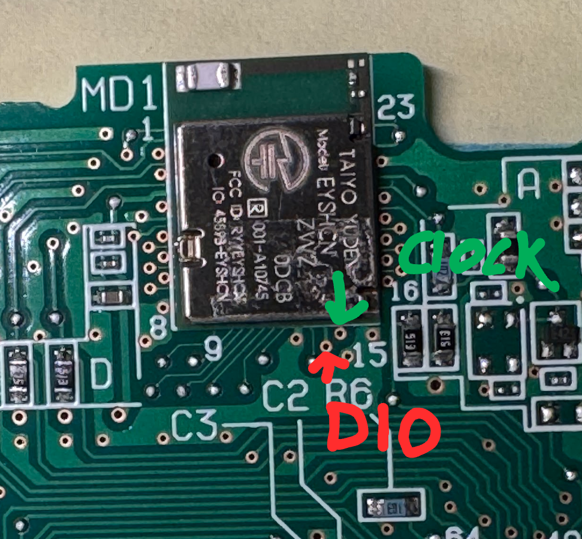

**Documentation:** [Install](install.md) • [Backup & restore](backup-restore.md) • [Build](build.md) • [Config](config.md) • [VIA](via.md) • [Hybrid port](hybrid-port.md) • [Hybrid updates](hybrid-update.md) • [Hybrid hardware](hybrid-hardware.md)

# HHKB Professional Hybrid port: status and ToDo

Work in progress on branch `hhkb-hybrid`. The test keyboard is a Hybrid Type-S (PD-KB800BS, USB `04FE:0021`, stock firmware A0.48). Everything below the "Findings" heading comes from static analysis of PFU's `HHKB800_FW_A048.hfb` (Hybrid) and `HHKB401_FW_A803.hfb` (Classic Type-S), unless marked as tested.

## Current state of the test keyboard (2026-11-15)

- **Reassembled:** no SWD or power analyser attached, batteries in, usually on USB and paired to a Mac in slot 1. A full backup (both chips, EEPROM, option bytes, SHA-256 sums) is in `backups/hybrid-2026-11-14/` (git-ignored).
- **Both chips run ECK, installed and updated over USB only** ([hybrid-update.md](hybrid-update.md)): from stock through PFU's updater, then Bank 1 replaced by ECK's boot stub (`stm32/boot/`). Tested round trip: ECK → stock (both chips byte-identical to PFU's) → ECK.
- **Bank 1 holds ECK's boot stub** (PFU's original is in the backup). **Option bytes** (RDP level 0, no write protection, BFB2 off), the nRF52 **MBR, SoftDevice and PFU bootloader** are unchanged.
- The keyboard must be on a USB **host** for USB tests: on a power bank, ECK sees no host and sends everything to Bluetooth.

## SWD on the Hybrid (tested; not wired now)

The five pads sit just below CN3, as on the Classic: `GND NRST VCC` over `SWCLK SWDIO`. Pad order was not checked separately; the connection works with this wiring.

- **NRST is required.** ECK's idle hook runs `wfi`, which stops the debugger's bus clock on the STM32L0 (no `DBGMCU` sleep bit set), so a running ECK only accepts connect-under-reset.
- STM32CubeProgrammer: `STM32_Programmer_CLI -c port=SWD freq=1000 mode=UR reset=HWrst`, then `-u` to read, `-w <bin> 0x08010000 -v` to write Bank 2, `-w32` for EEPROM words.
- `tools/bench/swd_flash.py <.hfb|.bin>` writes Bank 2, sets the two boot words below and resets.
- Hybrid builds set `DBGMCU_CR.DBG_SLEEP` when booted on USB power (PC13 low), so `mode=HOTPLUG` attaches to a running build without a reset; on batteries they clear it (it keeps the core clock running in Sleep).

## Updates (tested)

- **STM32:** ST's USB DFU loader in system memory (`0483:DF11`; flash, data EEPROM and option bytes). Its reset code jumps back into any valid flash bank unless the BOOT0 pin selected it, so `stm32/hybrid/rom_dfu.h` runs the ROM's data init and enters the loader after that check (ROM contents checked first). The interrupts have to be enabled on entry, or the loader's USB never answers.
- **Bank 1 boot stub** (`stm32/boot/`, 720 bytes): DFU loader if the power switch is held with USB power present or Bank 2 fails the boot rule below, else Bank 2.
- **nRF52:** VIA id 30 → link frames `BLE_LINK_UPDATE` (22 data bytes each) → the nRF52 app (`nrf52/nrf_update.c`) stages the image at `0x37000` with the record at `0x36000` that PFU's nRF52 bootloader installs at the next reset ([hybrid-stock-behaviour.md](hybrid-stock-behaviour.md), nRF52 staging). The SoftDevice is stopped during staging. Bonds (FDS, `0x75000-0x77FFF`) are outside the staging area. The matrix scan drops to 50 Hz meanwhile; at 1000 Hz it starved the link task (20 ms per chunk instead of 2.2 ms).

## Bank 1 boot rule (tested)

- Bank 1 boots Bank 2 when EEPROM `0x08080360 = 1` and `0x08080370` holds the CRC-16/MCRF4XX of the 64 KB Bank 2 image (the `.hfb` inner CRC, as a little-endian word). With `0x370 = 0` it stays in the updater (`04FE:0021`, "Bank 1 recovery" in `hhkb_flasher.py --info`).
- After an SWD write to Bank 2, set both words or Bank 1 will not boot the new image.
- Clearing `0x370` alone is enough (tested). ECK's boot stub checks the same rule, so either Bank 1 boots ECK. The bootloader key now starts ST's DFU loader instead, on USB power only; on batteries or an unknown ROM it does nothing and the keyboard keeps running.
- Bank 1 cleared `0x08081350` when it entered the updater; its meaning is not known yet.

## nRF52 (tested)

- **SWD:** module MD1 (Taiyo Yuden EYSHCNZWZ) pin 14 = SWDIO, pin 15 = SWDCLK, pin 13 = GND, reached through the two vias just below the module's bottom-right corner, next to the "15" silkscreen: SWDCLK the upper one, SWDIO the lower one (photo below). Works with a Pico debugprobe through pyOCD (`-t nrf52832 -O auto_unlock=false`; never let pyOCD auto-unlock, it mass-erases).

  
- **Not read-protected** (CTRL-AP APPROTECTSTATUS = 1, UICR APPROTECT erased). Full backup in `backups/hybrid-2026-11-14/nrf52/` (flash 512 KB, UICR, FICR, SHA-256 sums).
- **Chip:** nRF52832 variant AAE0, 512 KB flash, 64 KB RAM.
- **Flash layout:** MBR `0x0`, S132 v6.0.0 `0x1000`, PFU app `0x26000` (45 KB), app data `0x70000-0x78000` (likely bonds), PFU bootloader `0x78000` (UICR BOOTLOADERADDR). `0x1000-0x36000` matches the stock `.hfb` byte for byte.

### STM32 to nRF52 wiring (tested with `tools/bench/pin_map.py --drive`)

| Signal | STM32 | nRF52 |
| --- | --- | --- |
| CS (GPIO on nRF52) | PA15 (SPI1 NSS) | P0.22 |
| SCK | PB3 | P0.25 |
| nRF MOSI / STM32 MOSI | PB5 | P0.23 |
| nRF MISO / STM32 MISO | PB4 | P0.24 |
| request / wake to nRF52 | PB6 | P0.18 (SENSE input) |

- Stock: the nRF52 is the **SPI master** (legacy SPI0, mode 3, MSB first) and the STM32 SPI1 the slave.
- **PD2 high holds the nRF52 in reset** (tested with `tools/bench/nrf_reset_probe.py`): the nRF52 stops answering SWD while PD2 is high and restarts with reset reason RESETPIN. UICR PSELRESET is P0.21, so PD2 reaches it through an inverter. Bank 1 pulses it at start-up; ECK drives it low.
- The board pulls SCK (PB3/P0.25) up: it reads high with the STM32's internal pull-down and only ECK's app (an SPI slave) on the nRF52.
- PC5 is the power switch and PC13 low means USB power (stock code, [hybrid-stock-behaviour.md](hybrid-stock-behaviour.md)). Not yet found: what P0.11/P0.12 (inputs with pull-ups) connect to.
- The four series resistors left of MD1 (box D) are not this link: their lines keep toggling with the STM32 halted.

### PFU's update path for the nRF52 (tested by observation)

Watched with `tools/bench/nrf_pc_monitor.py` (non-halting PC sampling) during a full update with stock nRF52 firmware:

- On entering the updater, Bank 1 resets the nRF52 through PD2; PFU's **app** starts.
- **Bank 1 then needs PFU's nRF52 app.** It makes SPI1 a slave (mode 3), raises PB6 (request to P0.18) and waits for the nRF52 to clock a transaction as master. PFU's app does; ECK's app (an SPI slave) does not, so with ECK's app installed **the updater enumerates (`04FE:0021`) but never answers HID requests**. Updates then need SWD, or the stock nRF52 app restored first.
- During the transfer PFU's app writes the nRF52 section to flash itself (staging).
- After the final command Bank 1 resets the nRF52 again; PFU's **bootloader** runs for about 4 s (copying the staged image), then the new app starts. `HYBRID_SETTLE_SEC` is now 15 s.

## Bluetooth (ECK-native)

- nRF52 app: [`nrf52/`](../nrf52/README.md) (nRF5 SDK 15.0.0 app on PFU's S132 v6.0.0 at `0x26000`; build, SWD flashing and its docs are there). The Hybrid build packs its `_build/nrf52832_xxaa.bin`; the link contract is `common/ble_link.h` (`BLE_LINK_VERSION`), which both builds include.
- BLE HID keyboard + consumer reports and the standard Battery Service (percent). The STM32 reports the stock percent steps (100/15/5/0); the board only has level detectors, no voltage reading (see "Power, battery and LED").
- Link: `common/ble_link.h`, 32-byte frames, STM32 SPI1 master (PCLK/16: 2 MHz on USB, 1 MHz on batteries; mode 0), nRF52 SPIS. `stm32/hybrid/hybrid_ble.c` sends reports while no USB host is connected, or always when Bluetooth is preferred.
- Keys (stock, PFU manual P3PC-6641-01EN in `backups/vendor-docs/`): Fn+Ctrl+1..4 select a host slot and Bluetooth, Fn+Ctrl+0 USB. Fn+Q enters pairing standby (LED 2 blinks/s); then Fn+Ctrl+1..4 pairs that slot, Fn+Ctrl+Delete+1..4 forgets its host, Fn+Z+Delete forgets all; Fn+X cancels. The chords go by key position (the Fn key, or the left ◇ with SW4; left Ctrl; the number row, Q, X, Z, Delete: `stm32/hybrid/hybrid_chords.c`), so a VIA remap of those keys does not change them, and their presses never reach the host. Slot, mode and Bluetooth scan rate persist in EEPROM `0x080817F8`.
- **Slots:** each slot has its own static random address (slot 1 = the chip's own, slots 2-4 change the lowest byte), so a host bonded in one slot never sees the others. Only the slot's bonded host may connect (whitelist). An empty slot does not advertise.
- **Pairing:** pairing a slot deletes its bond and advertises to anyone, discoverable, as `HHKB-Hybrid_n` for 10 min (LED 4 blinks/s; tested over SWD with `tools/bench/hybrid_cmd.py` and a BLE scan). Re-pairing an existing bond is allowed only then. Passkey entry with MITM: the host shows a code, the digits and Return typed on the keyboard go to the nRF52 (link flag `BLE_LINK_ST_PASSKEY`), not the host. Keys of 16 bytes; LESC offered (SDK's Oberon library; a Mac's choice not checked). A connection not encrypted within 30 s is dropped. Connection parameters follow Apple's Accessory Design Guidelines R32 section 57.6 (request 15-30 ms, latency 30, 6 s timeout); a Mac granted 15 ms, latency 22, 2 s. The status reply (link v4) carries the granted values. Bonds survive nRF52 updates (tested 2026-11-15) since the slot tag is stored from a static buffer. With no host paired and no USB host 3 s after start-up, slot 1 enters pairing (stock first use).
- **Start-up:** bonds without ECK's slot tag (e.g. PFU's, which hold one host several times and made the SoftDevice reject the identity list) are deleted, so no manual erase is needed after installing.
- **Full queue:** when the link queue is full, the newest keyboard (and consumer) report is held and sent once it drains, instead of failing (the USB layer treated a failure as a transport switch and dropped the report, which could leave a key stuck on the host). Not yet seen by hand.
- **Transport:** reports go to Bluetooth when no USB host is mounted or Bluetooth is selected; with Bluetooth selected but not connected they are dropped, not sent to USB. On a switch, the transport left behind receives an all-keys-released report.
- **Scan rate:** the matrix runs at the Bluetooth rate (default 250 Hz, VIA id 29) while reports go to Bluetooth and at the USB rate otherwise (default 1000 Hz, as on the Classic).
- **LED mode 5, Bluetooth status** (Hybrid default for PA8; PA9 defaults to off, as stock keeps the LED dark): the manual's patterns, i.e. 1 s on after start-up, a slot or USB switch or cancel; 4 blinks/s while pairing or waiting for a passkey; 2 blinks/s in pairing standby; otherwise off, also while reconnecting (the owner wants no light in normal Bluetooth use). Power indications (below) override both pins; PA9 (orange) wins over PA8 (blue) as in stock's LED driver. Colours confirmed on the board (PA8 blue, PA9 orange).
- VIA: the shared `via.json` has the Bluetooth scan rate and LED mode 5, marked "(Hybrid)"; the Classic ignores both.
- State over SWD without halting: `tools/bench/hybrid_state.py --stm <uid> --nrf <uid>`; send bridge commands with `tools/bench/hybrid_cmd.py --stm <uid> pair 2|cancel|select 1|delete 2|clear`; watch input pins with `tools/bench/watch_inputs.py`.
- **SWD read glitch:** reads of STM32 SRAM or peripherals sometimes return 0 while the core sleeps (seen as a whole word of zeros). Repeat a surprising read before trusting it.
- Logs: `tools/bench/rtt_dump.py --uid <probe> --cb <_SEGGER_RTT address>`.

## Key sensing (measured 2026-11-15, `tools/bench/key_depth.py`)

Needs `HHKB_ADC_DIAGNOSTICS` in the build (VIA reads each key's reading over USB).

- Rest readings 40-520 counts, a full press ~2700 (swing ~2300-2700). PFU's factory press thresholds in the EEPROM: 1660-2130, about 60-75 % of the swing. ECK's uncalibrated generic scale (rest 800, range 1000) fits this sensor badly; factory thresholds are the default: a keyboard with no saved settings starts with custom calibration and Rapid Trigger off; saved settings keep their own choice.
- **Noise came from interrupts during the scan.** Each reading depends on the timing since the previous key (discharge, row strobe, mux settling), so an interrupt inside a scan (system tick, USB, including the VIA reads that measured it) skewed readings by up to ~200 counts, in a beat with the 2 ms scan (spikes ~173 ms apart). The scan now runs with interrupts held off (<1 ms): spikes went from ~5 per 1000 readings to none, typical spread from ~10 to 2.4 counts. Disproved on the way: the nRF52 radio (spikes stayed with it off and with scans timed between radio events; the DC/DC stays on, its LDO mode was noisier), the boost converter.
- The first key read (c0r0, Left Shift) also needs the amplifier to settle after it is switched on each scan: a 20 us wait (`HHKB_OPAMP_SETTLE_US`) took its spread from ~65 to 3 and fixed erratic Left Shift presses.
- 1000 Hz chattered before the interrupt fix (500 Hz did not); 1000 Hz is the USB default again; no chatter in hand typing (2026-11-15). 4x oversampling applies at 500 Hz or less, on USB only (`stm32/ec/classic_matrix.c`).
- Calibration took the rest level from one scan and accepted keys 150 counts above it, which the old noise reached: unpressed keys got noise-sized ranges. Now the rest level averages 16 scans and a key needs 600 counts.
- Rapid Trigger against recorded rest noise (`tools/bench/rt_noise_sim.c`, a key held at 60 % depth): with the old noise the default 25 permille toggled ~5 times a second; with the fix there are no false toggles at 25. Not yet tried by hand.

## Power, battery and LED (ECK)

`stm32/hybrid/hybrid_power.c` (hardware) and `hybrid_power_logic.c` (pure logic, `tests/test_hybrid_power.c`). It runs from the HHKB platform tick in the keyboard task (no extra task or timer); the tick wakes every 100 ms, every 10 ms while the switch is down. Stock details: [stock behaviour, "Power, battery and LED"](hybrid-stock-behaviour.md#power-battery-and-led-stock-stm32-app-and-pfu-nrf-app-eck-follows-them). Manual: PFU P3PC-6641-01EN (`backups/vendor-docs/`).

| Item | ECK behaviour | Source |
| --- | --- | --- |
| Battery level | PB7/PB8/PB9 read every 100 ms (inputs, no pull: stock pull not found), stock filter (worse level at once, better after more than 10 samples), 100/15/5/0 %, 100 % while PC13 shows USB power. Sent to the nRF52 (percent only) on change and again after a link restart | stock |
| Low battery | Orange: 1 blink every 30 slow counts (33 s) at level 1, 2 blinks every 15 counts (16.5 s) at levels 2-3, blinking at once on a new level; only on batteries with Bluetooth as transport | manual p.3, stock timing |
| Empty at power-on | 11 samples (1.1 s); level 3 on batteries: orange 2 s, then OFF | stock |
| Power switch PC5 | Pull-up, 2-sample debounce. Light press (100 ms-2 s): blue blinks the slot number (0.3 s phases) on Bluetooth, or lights 1 s on USB. 2 s hold: OFF. A press held through boot is ignored until released | manual p.4, p.12 |
| OFF | Orange at least 1 s and until the switch is released; `BLE_LINK_CMD_POWER_OFF` to the nRF52 (disconnect, stop advertising, System OFF once bond writes finish); USB pull-up off; ADC off; sensor supply PC14, op-amp, discharge, mux and row lines low (stock idle levels not known); DIP, battery and SPI data pins analog; STOP (low-power regulator, wake clock HSI16) with EXTI on PC5 and PC13 falling | manual p.4, stock |
| Power-on | From STOP: switch held 1 s lights blue, release resets (`NVIC_SystemReset`); released earlier, back to STOP. USB power appearing (PC13 falling) resets too. Inserting batteries (power-on reset, no USB) goes to OFF quietly after the start-up battery check, as stock does (tested with the PPK2); `RCC->CSR` tells it from our own software reset. At boot the link task resets the nRF52 through PD2 if it does not answer within 500 ms (System OFF) | manual p.4, p.7 |
| Auto power-off | Batteries and SW6 OFF only: 60 min without a key press (owner's choice; the manual says 30); 10 min in pairing mode without a key press; 1 min advertising to the slot's host without connecting (stock 1-min mode timer, matches "turns off if the device is not ready", p.7). Time on USB power never counts. All three enter deep sleep, not OFF: any key wakes the keyboard (reset, 1 s blue), as do the switch and USB power. Only a 2 s switch hold enters OFF | manual p.3, p.6 (*3, *4), p.7 |
| Pairing deletes | Fn+Ctrl+Delete+n and Fn+Z+Delete enter OFF after the delete; the nRF52 waits for the flash writes before System OFF | manual p.14-15 |

Not done or guessed: stock's 10 s hold on wake (blue off, orange 3 s) is not copied; stock's "recovering to level 1 latches as 2" filter quirk is not copied; empty batteries leave the switch able to wake (stock masks it), so a press shows orange again; the matrix idle levels and PB7-PB9/PC13 pulls are guesses; the 10 min value comes from the manual, not the stock code; the 60 min idle time replaces the manual's 30 min (owner's choice).

## Builds

- `./build.sh hybrid`: ECK for the Hybrid. Produces `build/hybrid/hhkb_ec_hybrid.hfb` from ECK's own parts and Nordic's S132 v6.0.0 SoftDevice (`HHKB_HYBRID_SOFTDEVICE`, default `../nRF5_SDK_15.0.0/.../s132_nrf52_6.0.0_softdevice.hex`) plus ECK's nRF52 app (`nrf52/_build/nrf52832_xxaa.bin`, which `build.sh` builds first). No PFU file is needed: PFU's copy of the SoftDevice is byte-identical to Nordic's, and the output matched the earlier PFU-based build byte for byte. Installing it from stock through PFU's updater with `hhkb_flasher.py` was tested end to end (both chips).
- Without PFU's `.hfb` (CI, fresh clones) the Hybrid build makes only `build/hybrid/hhkb_ec_hybrid.bin`, which `hybrid_update.py stm32` installs.
- Never run a ECK STM32 build against PFU's nRF52 app: both act as SPI master on the same lines.
- EEPROM: ECK's Classic slots (`0x08080600..0x08080D9F`, `0x08081500`) were all zero in this keyboard's dump, and the factory calibration at `0x08081100`/`0x08081200` uses the Classic layout, so the Hybrid shares the Classic storage code. Stock keymap saves at `0x08081400 + n*0x100` would overlap `0x08081500`, which only matters when returning to stock.

## ToDo

Everything below runs over USB unless it says otherwise.

### Next

1. **Key sensing:** Rapid Trigger by hand (see Key sensing).
2. **Bluetooth while on USB:** ECK keeps the connection up on USB so Fn+Ctrl+1 switches at once; dropping it is an owner decision.
3. **Hand tests not yet done:** a second host in slot 2 (the Mac must not lose slot 1), Fn+X cancel, DIP switch modes, pairing a host with LESC.
4. **nRF52 pins:** what P0.11/P0.12 (inputs with pull-ups) connect to.

### Power measurements (PPK2 on the battery terminals, 2026-11-15)

OFF at 3.0 V: ECK 197 µA, stock 198 µA (a ~130-140 µA base plus boost-converter bursts every 7.5 ms: the board's floor). Running, idle on Bluetooth: stock 5.1 mA; ECK at first 10.1 mA. Measured costs: 32 MHz PLL ~2.5 mA, USB with HSI48/CRS 1.4 mA, always-on ADC plus DIP pull-ups ~1.1 mA, scanning ~6 µA per Hz, nRF52 idle ~0.3 mA. ECK now on batteries: 16 MHz without the PLL, USB off, ADC on only during scans (5.4 mA idle, 7.5 mA pairing); idle stage after 5 s without keys (50 Hz scan, STOP between scans via LPTIM1 on LSI, DIP pull-ups released): 1.50 mA connected, 4.3 mA right after typing; deep sleep after 60 min (nRF52 System OFF, STM32 woken 8 times a second for one key check): 0.33 mA. Rows driven low with the sensor supply on draw ~0.75 mA. SWD failed on battery power only (cause unknown). Battery thresholds: [hybrid-hardware.md](hybrid-hardware.md).

### Smaller items

1. **HSI48 start (fixed, untested as a cause).** Bank 1 leaves HSI48 running with `ENREF_HSI48` set on the Hybrid, so it did not cause the original hang. The fix matches ST's HAL and stays; verify it on a Classic.
2. **ADC diagnostics (resolved).** `./build.sh hybrid -d HHKB_ADC_DIAGNOSTICS` fits again (the STM32L072 FreeRTOS heap is now 512 bytes). All keys, columns 5 and 6 included, rest at 25-690 counts against factory press thresholds of 1560-2190; the earlier zeros were most likely the SWD read glitch.
3. **Housekeeping.** The module datasheet is in `backups/vendor-docs/`, the SDK zip next to the unpacked SDK.
4. **Restoring stock** is `hybrid_update.py nrf` then `restore-stm32` (tested); it needs the user's own Bank 1 backup.
5. **Link version:** the STM32 never checks `BLE_LINK_VERSION`. Left so: the `.hfb` always packs matching firmware, and refusing a mismatched nRF52 would also block the update that fixes it.

### Done

- Start-up crash fixed (pending SysTick from Bank 1); SWD set up on both chips; full backups; Bank 1 boot rule found.
- Full ECK Hybrid build over USB, installable through PFU's updater (tested).
- STM32-nRF52 link mapped; ECK's own nRF52 Bluetooth bridge; typing over Bluetooth works; host slots and stock key combinations built.
- One `.hfb` installs both chips from stock (tested); PD2 confirmed as the nRF52 reset; PFU's updater path observed.
- USB updates without PFU's updater: ST's DFU loader for the STM32, ECK's link for the nRF52, Bank 1 boot stub with recovery, stock restore (all tested). LESC pairing (SDK's Oberon library; untested with a host).
- Power switch, OFF state (STOP, power-on by reset), battery levels and warnings, orange LED priority and auto power-off, per the manual (bench-tested 2026-11-15). Low-power operation on batteries, idle stage and deep sleep with key wake (measured above). Recovery gesture tested by hand: with no other power, hold the switch and plug USB in -> `STM32 BOOTLOADER`.
- Review fixes: whitelist and address changes only while advertising is stopped, per-slot addresses, pairing window, PFU bonds cleaned up, stuck keys on transport switch, link resend and link-down handling. Tested by hand (2026-11-15): plugging USB in while switched off turns the keyboard on; no stuck keys after a restart with a key held. Separate Bluetooth scan rate, Bluetooth status LED, nRF52 licence note (`nrf52/README.md`).

### Classic issues found along the way

1. The SW6 recovery path (`hhkb_enter_bank1_updater`) differs from stock: it writes `0x08080348` (inside the factory info block) and erases the Bank 2 vector page, while stock command E0 writes the three updater words and resets.
2. `platform_bootloader_jump` (VIA command 0x0B, `K_BOOTLOADER`) jumps into the ST system ROM without a reset.

## Findings

### Update container (`.hfb`, 282,672 bytes)

| Offset            | Content                                                        |
| ----------------- | -------------------------------------------------------------- |
| `0x00000`         | Outer CRC-16/MCRF4XX over the rest of the file                 |
| `0x00002`         | Inner CRC over the 64 KB STM32 section                         |
| `0x00004`         | STM32 Bank 2 image (`0x08010000`), 64 KB                       |
| `0x10004`         | 12 x `0xFF`                                                    |
| `0x10010`         | MD5 of the nRF52 section                                       |
| `0x10020`         | nRF52832 image from nRF address `0x1000`: S132 v6.0.0 SoftDevice + app at `0x26000` |
| end - `0x10`      | Model `AHUX01`, version (`0A 00 04 08` = A0.48), 6 x `0xFF`    |

Bank 1 relays the nRF52 part over SPI in 57-byte chunks as they arrive. `make_hfb.py --nrf-app --softdevice` builds this layout from scratch (model `AHUX01`, version A0.48, as PFU's file).

### STM32 pins (identical to the Classic stock firmware)

Rows B0/B1/B2/B10 (B11 is an unused fifth row slot on both models), mux address B12-B14, mux enables C6/B15, op-amp C7, discharge C8, sensor power C14, ADC channel 1 (PA1), keys indexed `8*col + row`, LEDs A8/A9, DIP switches A3-A7 + C4 (active low). Also on both: outputs B6, C9, D2; inputs A10, B7-B9; falling-edge interrupts C5/C13. The only difference: the Classic parks the SPI1 pins (B3-B6, A15) as plain outputs because it has no nRF52.

### Stock firmware behaviour

- Command E0 (enter updater) writes EEPROM words `0x08080360=0`, `0x08080370=0`, `0x08081350=1`, then resets (Hybrid `0x801abd2`, Classic A8.03 `0x801a326`).
- `0x08080348` is not a flag: it lies in the factory info block (`0x310-0x34F`) that command 0x02 returns.
- Command E5 erases Bank 1 immediately. Never send E4-E7.
- No watchdog. Bank 2 code can read Bank 1.

### Tested on hardware

- `hhkb_flasher.py --info` works on the Hybrid over USB (the keyboard must be in USB mode, Fn + Control + 0, or it connects over Bluetooth only).
- Rehearsal: stock A0.48 reinstalled over stock with the extended flasher: 166 s transfer, final command acknowledged, keyboard returned as stock, USB typing and Bluetooth pairing intact.

## Tools

Bench, measurement and reverse-engineering tools are in `tools/bench/` (most need SWD, so the case open); installing and building need only `tools/make_hfb.py`, `hhkb_flasher.py` and `hybrid_update.py`.

- The Hybrid container needs the nRF52 app and Nordic's SoftDevice `.hex` (`-DHHKB_HYBRID_NRF_APP=...`, `-DHHKB_HYBRID_SOFTDEVICE=...`); without them the build makes only the STM32 `.bin`. PFU's own file is needed only to go back to stock.
- `tools/make_hfb.py --nrf-app --softdevice`, `tools/bench/nrf_reset_probe.py` (PD2 test), `tools/bench/nrf_pc_monitor.py` (which nRF52 image runs, without halting), `tools/bench/hybrid_state.py` (bridge state on both chips), `tools/hhkb_flasher.py` (Hybrid size, MD5 and model checks, longer waits); `hybrid_update.py boot` saves Bank 1 and the EEPROM before its first write.
