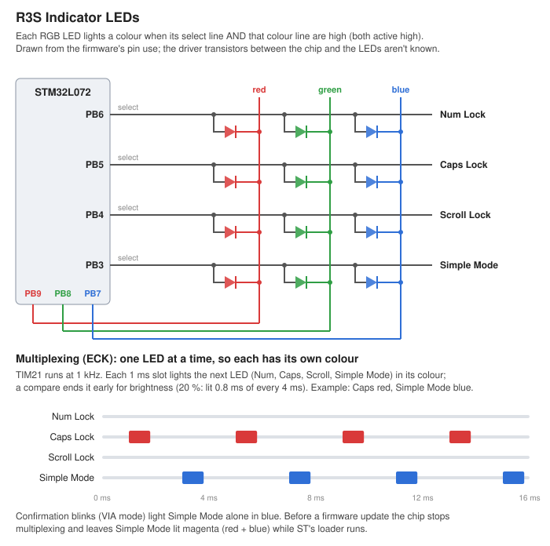
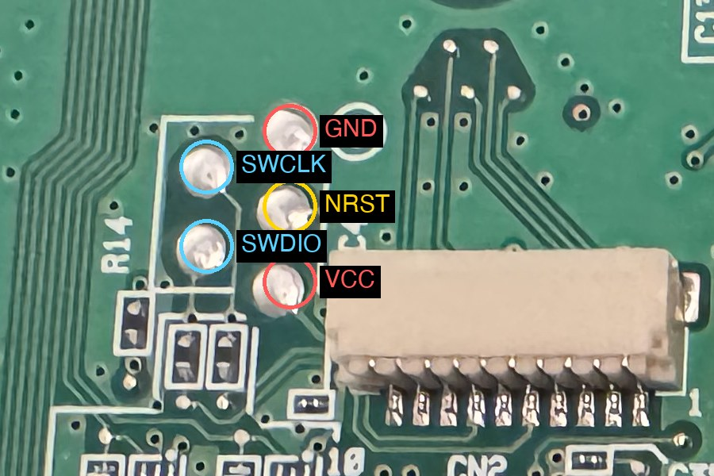

[ECK docs](overview.md)

# Realforce R3S hardware (wired TKL)

What is known about the Topre Realforce R3S US TKL (`R3SD13`, firmware A011) for an ECK port. Read from the stock Bank 2 image (`R3SD_verA011.rfb`) on 2026-11-17: data tables, the scan and start-up code, and an emulator run of start-up (`tools/r3s/emulate_stock.py`). ECK has run on it since the bring-up below; open items: [deferred.md](deferred.md).

## MCU, memory and updates

| | |
| --- | --- |
| MCU | STM32L072RBT6 (LQFP64), 32 MHz from the PLL |
| Readout protection | Level 0 (option bytes `aa 00 55 ff`) |
| Bank 1 | Topre's updater (HHKB-style protocol under VID `0x0853`, PID `0x0313`) |
| Bank 2 | Application at `0x08010000`, container `.rfb` (below) |
| Bank 2 tag | EEPROM word `0x080817E0`: CRC-16/MCRF4XX of the 64 KB image in bytes 2-3 |
| Other EEPROM data | `0x000-0x05F`, `0x500-0xBFF`, `0x17C0` (contents below) |

Topre's `R3SD_verA011.rfb` uses the `.hfb` container (same two CRC-16/MCRF4XX, 64 KB Bank 2 image linked at `0x08010000`) with a different 32-byte trailer: 12 × `0xFF`, model ID `R3SD####`, version bytes `0a 00 01 01` (A011), 4 × `0xFF`. Stock firmware answers the PFU updater query (`AA AA 02`: model `R3SD13` followed by `0x10`, not a zero, version A011) and accepts E0-E3 updates. After writing Bank 2 the updater also writes `01 00 02 00` after the tag word (meaning unknown). EEPROM `0x340-0x37F` is unused, unlike the HHKB.

Backed up 2026-11-17 (EEPROM, both banks, option bytes; owner's `backups/r3s-stock-*`) with `tools/r3s/`: a temporary Bank 2 image installed through Topre's updater starts ST's DFU loader (the Hybrid's ROM entry matched), then the stock image went back over DFU.

## Key matrix

Two 8-channel analog muxes give 16 columns; 8 drive lines give rows, of which the TKL uses 6. The firmware's key index `i` (0-127) reads mux 1 for `i < 64`, mux 2 otherwise; within a mux, channel `(i % 64) / 8` and drive line `i % 8`. So column = `i / 8` (0-15), row = `i % 8`.

| Signal | Pins | Notes |
| --- | --- | --- |
| Drive lines (rows 0-7) | PC13, PC14, PC15, PC0, PC4, PC3, PC1, PC2 | Idle high, the selected row is driven low; rows 6-7 unused on the TKL |
| Mux address (channel bits 0, 1, 2) | PB14, PB13, PB12 | |
| Mux enables | PB11 (columns 0-7), PB10 (columns 8-15) | Low = enabled |
| Sense input | PA4 (ADC_IN4) | Stock sets it as a digital input; ECK should use analog mode |
| Per-key control | PC5, PC11 | See the sequence below; roles inferred |

Layout tables at `0x0801D490` (TKL, JIS/ISO keys), `0x0801D510` (TKL ANSI), `0x0801D590` and `0x0801D610` (full size) give an IBM key number per index. The model string's 4th character picks the table (`A`-`D` = 0-3); `R3SD` uses `0x0801D510`. Key numbers map to HID codes through the table at `0x0801D730` (16-bit little-endian, key 1 first; corrected 2026-11-21); a few keys (29 `\`, 69) take their code from elsewhere.

The full-size stock image (`R3SB_verA012.rfb`, model `R3SB####`, version A012; read 2026-11-21) holds the same four tables byte for byte, moved to `0x0801D864` (+0x80 each) with the HID table at `0x0801DAFC`. Its full-size tables (108 keys ANSI, 111 JIS/ISO) use all 16 columns and rows 0-2 and 4-7: row 3 (PC0) is empty. An ECK port skipping that row has 112 positions; a test build (108 keys, 7 rows, settings record 472 B) left 912 B RAM free beside the then 2 KB interrupt stack (1 KB since 2026-11-21: about 1.9 KB free), and 16 x 8 doesn't fit the TKL's EEPROM map (settings record 536 B > 512 B). Its EEPROM use hasn't been compared with the TKL's.

ANSI TKL (`R3SD`), column across, row down (`.` = no key):

```
      0    1    2    3    4    5    6    7    8    9   10   11   12   13   14   15
0    F4   F5   F6   F3  Esc   F2    .   F1 PScr ScLk Paus  F11   F7  F10   F8   F9
1     5    6    7    4    `    3    1    2  F12 Home PgUp    =    8    -    9    0
2     T    Y    U    R  Tab    E    Q    W Bksp  Ins PgDn    ]    I    [    O    P
3     G    H    J    F Caps    D    A    S    \  Del  End    .    K    '    L    ;
4     B    N    M    V LSft    C    Z    X  Ent Rght   Up RSft    ,    .  Dot    /
5   Spc    .    .    . LCtl    . LGui LAlt    . Down Left RCtl    .   Fn RAlt  k69
```

`Dot` is the period key. Key 69 is a bottom-row key whose code comes from elsewhere (likely App or right Win).

## Scan sequence (per key, interrupts off)

1. Enable the key's mux (PB11 or PB10 low, the other high); PC5 and PC11 high.
2. Set the mux address; wait ~35 delay units.
3. PC5 low; drive the row line low; wait ~5 units.
4. PC11 low; wait ~23 units.
5. One ADC conversion (sampling time 1.5 cycles, ADC clock from PCLK); all rows back high.

A delay unit is a counted loop of about 6 cycles (~0.19 µs at 32 MHz before flash wait states), so roughly 6.6 µs, 1 µs and 4.3 µs. Scan start sets PC11 high and enables mux 1; scan end turns PC11, rows and mux lines off. Two 1 ms timers (TIM21, TIM7) and a 1 s timer (TIM22) run; which one paces the scan isn't traced.

## LEDs and other pins

- Four RGB indicators, left to right Num Lock, Caps Lock, Scroll Lock, Simple Mode (Topre's manual; stock lets the user pick colour and brightness). Select lines PB6, PB5, PB4, PB3 (in that order), colour lines PB7-PB9; all active high. Checked with ECK on 2026-11-17: Caps Lock and Simple Mode light where expected; all three colour lines on gives white. PB9 red, PB8 green, PB7 blue (owner, 2026-11-17 and 2026-11-19). ECK multiplexes them: TIM21 lights one LED per 1 ms slot in its own colour, 5-25 % of the time each, colour and brightness set in VIA (IDs 34, 35; default red, 20 %; stored in the settings record's retired scan-rate byte with bit 7 set, so older records keep the defaults). Confirmation blinks light Simple Mode alone in blue; before ST's DFU loader, Simple Mode is left lit magenta (red + blue; owner's choice), as the jump keeps GPIOB (`ROM_DFU_KEEP_IOP`; yellow, then magenta, seen through updates, 2026-11-19). The colour lines have no timer output (datasheet DS10689 alternate functions), so no colour mix is possible while the loader runs.  (drawn by `tools/gen_r3s_led_svg.py`)
- SWD: five unpopulated pads above CN2, the HHKB's footprint turned 90°: GND, NRST, VCC in one column, SWCLK and SWDIO between them (owner's photo, 2026-11-21). Read from the photo, not yet confirmed with a meter: GND is the pad in the copper pour; NRST, the middle one, runs to C41.  (marked by `tools/annotate_photo.py`)
- PA1: switched on at start-up and with the LED code by stock; ECK turns it on at start (role unknown: LED or sensor supply).
- PC12, PA15: inputs with pulls set at start-up; PB0 is read once when choosing the layout (a board strap?). Roles unknown; ECK leaves them alone.

## ECK bring-up (2026-11-17)

`./build.sh r3s` (`boards/r3s/`): the stock pins and per-key sequence (scan details below). Esc and Caps Lock held while plugging in (start-up readings of 2000 or more; rest is at most 1146) enter ST's DFU loader (`BOARD_RECOVERY_KEYS`; two keys, as a BIOS boot menu takes Esc alone; the R3S has no recovery switch; up to v0.6.1 a 15 s wait for a USB host did this instead); `-d BOARD_SCAN_ONLY` builds one that sends no keys. Measured hands-off with `ECK_PRODUCT=R3S tools/bench/key_depth.py`:

| Settle (`R3S_SETTLE_US`) | Rest readings | Noise (median p-p) | Per key, interrupts off | Whole scan |
| --- | --- | --- | --- | --- |
| 7 µs (stock-like) | ~700-1140 | 19.5 counts | 16 µs | ~2.17 ms |
| 3 µs | ~185-1000 (median 738) | 45 counts | 12 µs | ~1.72 ms |
| 7 µs, per-column scan (current) | median +1.9% vs per-key (all within ±8%) | 10 counts (250 Hz), 17 (500 Hz) | 100 µs per column | ~1.59 ms |

The settle time matters, so 7 µs stays. The current scan (`r3s_matrix.c`) runs from RAM at O2, keeps interrupts off per column, sets the mux address once per column (rewriting it per key, as stock does, changes no pin) and does each key's result inside the next key's settle wait; that cut the scan from ~2.15 to ~1.59 ms and halved the rest noise. Default 500 Hz, no missed scans. 1 kHz would need ~3.5 µs per key cut from the analog waits (owner: 500 Hz is enough, 2026-11-17).

Full presses (all 87 keys, two `key_depth.py press` sessions): rest 691-1146 (median 895), full press 2585-3403 (median 3097), swing 1744-2404 (median 2175; weakest `\`). With ~20 counts of rest noise that is about 100:1, close to the HHKB. Without factory rest levels, ECK averages each key's reading over 16 scans at start-up (`BOARD_BOOT_REST`; above 1400 counts the key counts as held and keeps the default 900) and assumes a 2100-count range until the keyboard is calibrated. With that, all 87 keys rest at under 1% depth.

Topre's EEPROM data (stock backup of 2026-11-17, read 2026-11-21), 1,952 B in all:

| Range | Contents |
| --- | --- |
| `0x000-0x05F` | Model ID `R3SD13` (twice), then model, region letter and what looks like a serial number |
| `0x500-0x5FF` | Eight 32-byte headers tagged `REALFORCE` (`0x5A0` blank) |
| `0x600-0x6FF` | Eight 32-byte records, one per header: small settings values and 16-bit values 500-1700 (meaning unknown; stock copies EEPROM `0x000-0xBFF` into RAM structures at start-up and reaches them through pointers: `emulate_stock.py` logs the reads, 2026-11-21) |
| `0x700-0x7FF` | 256 bytes all `2`: per-key, probably the actuation point level (Realforce default 2.2 mm is the third of four) |
| `0x800-0x8FF`, `0x900-0x9FF` | Active keymap and Fn layer: 128 entries by IBM key number, 2 bytes big-endian (type, HID code); type `0x10`/`0xC0` on Fn keys (`0xC0 0xE2` is likely consumer Mute) |
| `0xA00-0xAFF`, `0xB00-0xBFF` | Factory default keymap and Fn layer, same format; equal to the flash table at `0x0801D730` except key 29 |
| `0x17C0-0x17FF` | Updater words and the Bank 2 tag (`0x17E0`) |

There are no factory sensor levels (the HHKB keeps 768 B of them), which is most of why Topre's share is smaller.

ECK's EEPROM use on the R3S avoids Topre's data: settings record at `0x100` (408 bytes), Vial entries at `0x300-0x437`, keymap slots at `0xC00-0x17BF`. Checked on the keyboard (2026-11-17): VIA keycode round trips and keymap reset (`ECK_PRODUCT=R3S via_keymap_check.py`), settings and keymap persisting across a restart with Topre's data untouched (`tools/r3s/persist_check.py`, which also covers the indicator style since 2026-11-21), and `ECK_PRODUCT=R3S tools/bench/vial_check.py` (2026-11-21).
