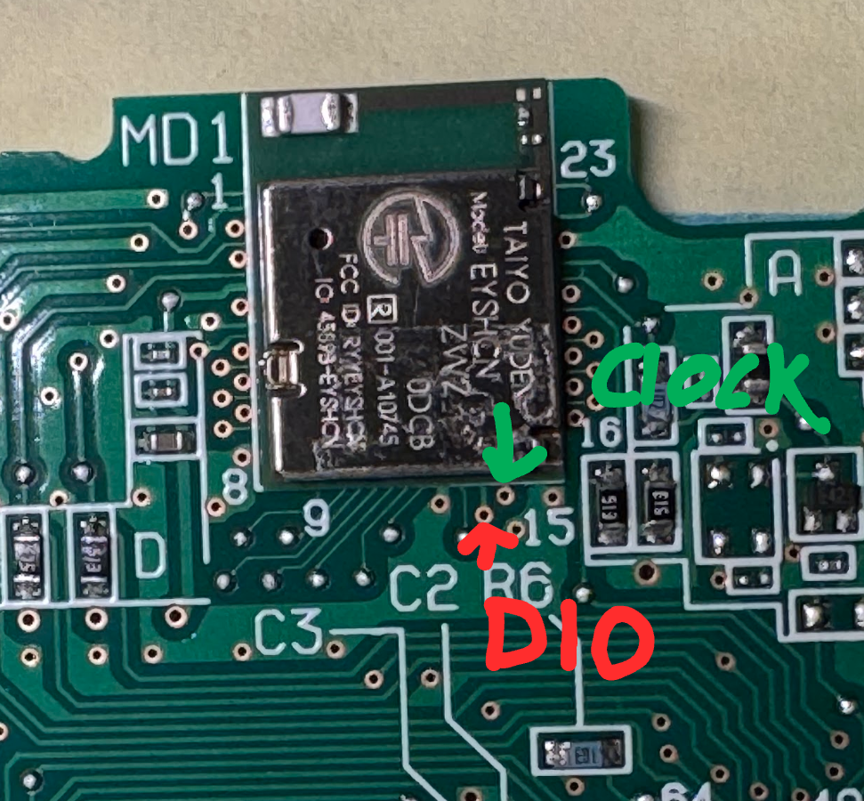

# nrf52: the nRF52 Bluetooth bridge for the HHKB Professional Hybrid

The app for the Hybrid's nRF52832 (Taiyo Yuden module MD1) that takes key reports from ECK on the STM32 over SPI and sends them as a BLE HID keyboard. It replaces PFU's nRF52 app; PFU's MBR, S132 v6.0.0 SoftDevice and bootloader stay on the chip.

Hardware, Bluetooth behaviour and PFU's bootloader: [docs/nrf52.md](docs/nrf52.md).

## Build

Needs the Arm GNU toolchain (`arm-none-eabi-gcc` on PATH) and the nRF5 SDK 15.0.0 (it matches the S132 v6.0.0 already on the module), unpacked at `../nRF5_SDK_15.0.0` next to this repository. From this directory:

```
make                          # or: make SDK_ROOT=/path/to/nRF5_SDK_15.0.0
make clean && make NRF_LOG=1   # with the RTT log for SWD debugging (about 9 KB larger)
```

Output: `_build/nrf52832_xxaa.bin` and `.hex`, linked at `0x26000` after the SoftDevice. It must fit the 64 KB app slot of the update container, hence `-Os`.

## Install

Normally over USB, through ECK:

1. The Hybrid firmware build (`./build.sh hybrid` at the repository root) packs `nrf52/_build/nrf52832_xxaa.bin` with Nordic's S132 v6.0.0 SoftDevice from `../nRF5_SDK_15.0.0` into the Hybrid `.hfb` (CMake cache variables `HHKB_HYBRID_NRF_APP` and `HHKB_HYBRID_SOFTDEVICE`); no PFU file is needed. Without them the build makes only the STM32 `.bin`. A ECK `.hfb` never carries PFU's app, which with ECK's STM32 firmware would make both chips drive the link as SPI master.
2. `uv run --with hidapi python3 tools/hybrid_update.py nrf <.hfb>` (from the repository root) sends the nRF52 part through ECK on the STM32 to this app, which stages it; PFU's bootloader installs it at the next nRF52 reset. Bonds survive.

Fallback over SWD (probe on the two vias below the module, photo below):

```
uv run --with pyocd python3 tools/nrf_flash.py --nrf <probe uid>
```

It erases only the app's sectors, writes, verifies and resets (`make flash` does the same without the verify). Never let pyOCD auto-unlock: it mass-erases the chip, including PFU's bootloader.



## Link protocol

`common/ble_link.h` defines the SPI link to the STM32 (32-byte frames, STM32 master, nRF52 slave); both builds include it. Bump `BLE_LINK_VERSION` (now 5) on any frame change. The nRF52 sends its version in every status reply; the STM32 does not check it yet.

## Licence

- `main.c`, `nrf_update.c/.h`, `config/app_config.h` and `tools/` are under the repository's MIT licence (`LICENSE` at the root); `main.c`'s SDK boilerplate (peer manager and advertising setup) follows the SDK's `ble_app_hids_keyboard` example. `config/app_config.h` overrides settings of the SDK's `ble_app_hids_keyboard` `sdk_config.h`, which the Makefile includes from the SDK.
- `Makefile` follows the SDK examples' layout (no Nordic notice in their makefiles).
- `hybrid_ble_gcc_nrf52.ld` is adapted from the nRF5 SDK and stays under Nordic Semiconductor's 5-clause licence (header in the file). The SDK sources are not in this repository (the first commit carried the SDK's `sdk_config.h`; the next one removed it).
- That licence allows binaries only on Nordic chips (true here), and exempts binaries inside a software update for such a product from reproducing the notice; a release that ships `nrf52832_xxaa.hex` on its own should include the notice anyway.
