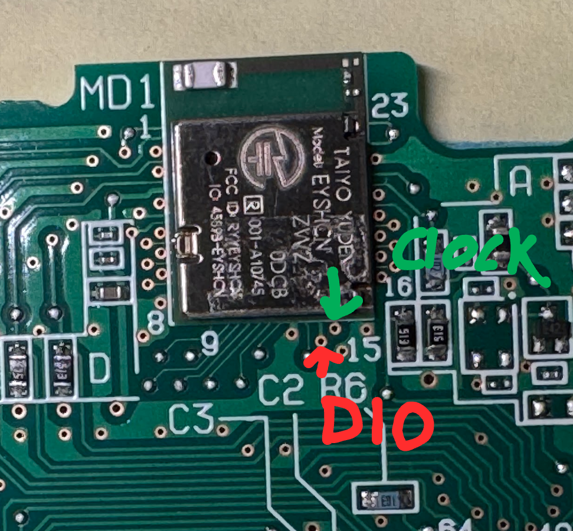

# HHKB Hybrid nRF52 notes

Taken from `docs/hybrid-port.md` and `hybrid-stock-behaviour.md` (branch `hhkb-hybrid`), which keep the STM32 side, power handling and the full analysis of PFU's stock link. Tested on a Hybrid Type-S (PD-KB800BS, stock firmware A0.48) unless marked otherwise.

## SWD

- Module MD1 (Taiyo Yuden EYSHCNZWZ) pin 14 = SWDIO, pin 15 = SWDCLK, pin 13 = GND, reached through the two vias just below the module's bottom-right corner, next to the "15" silkscreen: SWDCLK the upper one, SWDIO the lower one.
- Works with a Raspberry Pi debugprobe through pyOCD: `-t nrf52832 -O auto_unlock=false`. Never let pyOCD auto-unlock: it mass-erases the chip.
- Not read-protected (CTRL-AP APPROTECTSTATUS = 1, UICR APPROTECT erased).
- SWD fails on battery power only (cause unknown); keep the keyboard on USB power.

## Chip and flash layout

- nRF52832 variant AAE0, 512 KB flash, 64 KB RAM.
- MBR `0x0`, S132 v6.0.0 `0x1000`, app `0x26000`, update staging `0x36000-0x74000`, bonds (FDS) `0x75000-0x77FFF`, PFU bootloader `0x78000` (UICR BOOTLOADERADDR). PFU's bootloader starts the app at `0x26000` with no validity check.

## Wiring to the STM32

| Signal | STM32 | nRF52 |
| --- | --- | --- |
| CS (GPIO on the nRF52) | PA15 (SPI1 NSS) | P0.22 |
| SCK | PB3 | P0.25 |
| MOSI | PB5 | P0.23 |
| MISO | PB4 | P0.24 |
| recovery request | PB6 | P0.18 (high while the nRF52 starts: recovery mode) |

- ECK's link: STM32 SPI1 master (2 MHz, mode 0), nRF52 SPIS, one 32-byte frame each way per transaction (`common/ble_link.h`). PFU's stock link is the other way round: the nRF52 is the master (mode 3).
- STM32 PD2 high holds the nRF52 in reset (through an inverter to P0.21, UICR PSELRESET). ECK resets the nRF52 this way after power-on and when the link stops answering.
- The board pulls SCK up. Not yet found: what P0.11/P0.12 (inputs with pull-ups) connect to.

## Bluetooth behaviour

- BLE HID keyboard and consumer reports and the standard Battery Service (percent). The STM32 sends the stock percent steps (100/15/5/0) in the link's battery frame, which carries only the percent (link version 6); the board only has level detectors, no voltage reading.
- **Slots:** four host slots, each with its own static random address (slot 1 = the chip's own, slots 2-4 change the lowest byte), so a host bonded in one slot never sees the others. Only the slot's bonded host may connect (whitelist). An empty slot does not advertise. The STM32 selects the slot (stock keys Fn+Ctrl+1..4) and keeps it in its EEPROM.
- **Pairing:** pairing a slot deletes its bond and advertises to anyone, discoverable, as `HHKB-Hybrid_n` for 10 min. Re-pairing an existing bond is allowed only then. Passkey entry with MITM: the digits and Return typed on the keyboard come over the link (status flag `BLE_LINK_ST_PASSKEY`). LESC with the SDK's Oberon library (untested with a host). A connection not encrypted within 30 s is dropped.
- **Connection parameters** follow Apple's Accessory Design Guidelines R32 section 57.6 (request 15-30 ms, latency 30, 6 s timeout); a Mac granted 15 ms, latency 22, 2 s. The status reply (link v4) carries the granted values.
- **Bonds** carry ECK's slot tag; at start-up bonds without it (e.g. PFU's) are deleted. Bonds survive app updates.
- **Power off:** `BLE_LINK_CMD_POWER_OFF` disconnects, stops advertising and enters System OFF once bond writes finish.
- Logs go to SEGGER RTT (drop them with `make RELEASE=1`).

## Updates over the link

ECK on the STM32 relays the nRF52 section of a `.hfb` as `BLE_LINK_UPDATE` frames (22 data bytes each). `nrf_update.c` stops the SoftDevice, stages the image at `0x37000` and writes PFU's record at `0x36000`; PFU's bootloader installs it at the next nRF52 reset (STM32 PD2 pulse). This keeps PFU's bootloader and its record format, so going back to stock works the same way (send PFU's `.hfb`).

PFU's staging format (static analysis of PFU's app and bootloader, confirmed in code):

| Item | Value |
| --- | --- |
| Staged image | raw bytes of the `.hfb` nRF section (SoftDevice + app, image of `0x1000`..`0x36000`), at `0x37000` |
| Record | 7 words at `0x36000`: `u32 size; u32 0; u8 md5[16]; u32 crc`, crc = CRC-16/MODBUS (init FFFF, reflected 0xA001) over the first 24 bytes, zero-extended |
| Bootloader check | word 0 == FFFFFFFF: no new image, boot the app. CRC or MD5 (of `0x37000`+size) mismatch: erase staging and record |
| Copy | erase `0x1000`..`0x36000`, copy size/4 words from `0x37000`, MD5 over `0x1000`; OK: erase staging and record; fail: erase the app region and reset (retries next boot, record kept). About 4 s |
| Then | `sd_mbr_command(INIT_SD)`, vector base `0x26000`, jump to `0x26000` |
| Size limit | the bootloader erases only `0x1000`..`0x36000`; an image over `0x35000` would overwrite the record page (inferred) |

## Recovery mode

If an app's Bluetooth side is broken (it crashes in SoftDevice or BLE start-up, or never answers), it can still be replaced over USB. The STM32 holds PB6 high while it resets the nRF52 (`hybrid_update.py nrf --recovery FILE.hfb`, or the web flasher's checkbox). The app samples P0.18 first thing in `main()` (pull-down, 8 samples) and, if high, starts only the SPI link and the update receiver: no SoftDevice, status flag `BLE_LINK_ST_RECOVERY` (link v6). Any normal restart drops PB6. The STM32 resets an nRF52 found in recovery mode it did not ask for (at most 3 times), and restarts it normally before a power-off. A crash in recovery mode resets into it again. It does not cover an app too broken to reach `main()`; that still needs SWD.

## PFU's updater needs PFU's app

PFU's STM32 Bank 1 updater waits for the nRF52 to clock an SPI transaction as master. ECK's app is a slave, so with it installed PFU's updater enumerates (`04FE:0021`) but never answers HID requests. Update through ECK (above) or SWD instead, or restore PFU's nRF52 app first (`hybrid_update.py nrf` with PFU's `.hfb`).
